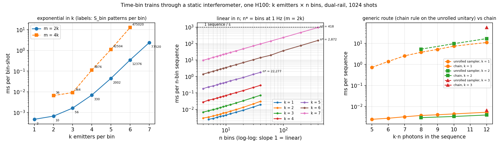
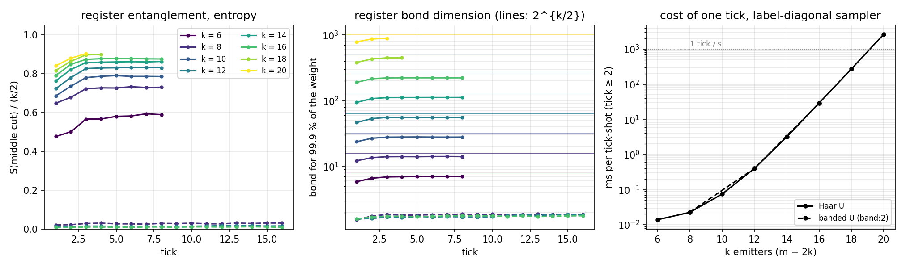

# Compute modality: k emitters × n time bins through a static interferometer

`photonic_engines/sequence.py` — `SequenceKernel`, `BinEmitter`. Tests: `tests/sequence/`.
Tutorial §9e. Added 2026-09-12.

## 1. The setting

k spin (or qudit) emitters, each producing a graph state of length n as a train of n photons
in successive time bins (caterpillar / linear cluster / GHZ per emitter, or any `EmitterMPS`
chain). The trains are **not** space-demultiplexed: emitter j sends its photon of every bin into
its own input modes of one universal m-mode interferometer U (two modes per emitter for a
dual-rail / polarisation label), the interferometer contains **no delay line**, and every bin is
detected as it exits. The object of interest is the k·n-photon output — the *sequence* of the
n per-bin detection patterns — as one state: its probabilities, marginals, correlations
between bins, and samples. This sits between a feed-forward stage simulator (one stage,
feed-forward, Kraus operators on the register) and plain Perceval (one Fock input, one output pattern).

## 2. Why it is a chain, not a k·n-photon problem

Without delay lines, photons of different bins never meet: the unrolled unitary on the m·n
(mode, bin) slots is block-diagonal, U ⊕ U ⊕ … ⊕ U. The only thing that correlates the bins is
the product spin register χ = Π dⱼ (2ᵏ for spins). Bin b is exactly one emitter *stage*
(k emissions on the product register, one circuit, full detection), and the k·n-photon output
is the stage iterated n times without feed-forward:

    p(t₁ … tₙ) = Tr[ K_{tₙ} ⋯ K_{t₁} ρ₀ K_{t₁}† ⋯ K_{tₙ}† ],      K_t = √N_t ⟨t|Φ_b⟩ ∈ ℂ^{χ×χ},

one Kraus operator per k-photon pattern t of the bin (S_bin = C(m+k−1, k) of them), obtained
by **one bond-carrying SLOS pass** on the k-emission stage MPS of the bin
(`EmitterSLOSKernel.kraus`, χ × the k-photon Fock cost). When U and the spin gates are the same
at every bin the set is computed once; per-bin unitaries `U[n, m, m]` (a reprogrammed
interferometer) or bin-dependent spin gates give one set per bin. With projected emitters the
photonic state is pure and its amplitude ⟨f|K_{tₙ}⋯K_{t₁}|s₀⟩ is an MPS along the bin axis with
bond χ and "labels" = bin patterns.

So the exponent is **k**, the number of emitters interfering in one bin (χ = 2ᵏ, 4ᵏ per Kraus
operator, S_bin patterns); **n**, the length of the graph states, is linear. The full k·n-photon
distribution has S_binⁿ entries and is never enumerated — the same status as the time-loop
engine's full distribution: everything one asks of it is a chain on the register.

## 3. Strong simulation

`SequenceKernel(emitters, m)`, `emitters` a list of `BinEmitter(ops [n, L, d, d], modes [L], s0,
final)` (`BinEmitter.caterpillar`, `.from_mps` for an `EmitterMPS` written on the unrolled
modes); U as a tensor, a Perceval
circuit, or one per bin.

| call | what | cost |
|---|---|---|
| `kraus(U, b)` | [S_bin, χ, χ] physical Kraus operators of bin b | one SLOS pass, χ² × the k-photon Fock cost |
| `sequence_probability(U, seqs)` | p(t₁..tₙ) for sequences as occupations [B, n, m] or pattern indices [B, n]; traced (Tr) or projected (\|⟨f\|M\|s₀⟩\|²) register | n · χ³ per sequence |
| `sequence_amplitude(U, seqs)` | ⟨f\|K_{tₙ}⋯K_{t₁}\|s₀⟩ (projected emitters) | idem |
| `bin_marginals(U, loss=η)` | [n, S_bin]: the register density matrix marched through the transfer channel E_b(ρ) = Σ_t K_t ρ K_t†; `loss=η` thins every bin (`LossyDistribution` per bin) | n · S_bin · χ³, differentiable in U and in the spin gates |
| `joint(U, bins)` | joint distribution of a few bins, tensor [S_bin]^{len(bins)} | S_bin^{len(bins)} · χ³ per bin in between |
| `transfer(U, b, ρ)` | E_b(ρ) | S_bin · χ³ |

`bin_marginals` is the readout a trainable layer would use (features on the spin gates or on
U); it is autograd-clean (the Kraus cache is bypassed under autograd).

## 4. Weak simulation

`sample(U, shots, loss=η)` → [shots, n, m]: **pure quantum trajectories** on the register. The
register starts in the pure product state |s₀⟩; at bin b the weights of the S_bin patterns are
w_t = ‖K_t ψ‖² = ⟨ψ|K_t†K_t|ψ⟩ (one matmul [shots, χ²] × [χ², S_bin] with the precomputed
K_t†K_t), t is drawn, ψ ← K_t ψ / ‖·‖, next bin. Exact, no mixed register (a stage simulator's sampling
mode diagonalises a mixed ρ because a stage may start from one; here the trajectory keeps it
pure), no rejection except for projected emitters (accepted at the end with probability
|⟨f|ψ⟩|², as in the time-loop sampler). Cost n · shots · S_bin · χ² by enumeration of the bin
patterns — the right route while S_bin · χ² fits (k ≤ 6–8). Beyond that, for label-preserving
emitters (a spin gate then an emission that keeps the spin in the emitted label — the
caterpillar), the same trajectory runs **without the Kraus set** (`sample_diag`, §9): K_t
factors through the label basis as V diag_x⟨t|U|x⟩ Uop, the bin is a mixture over the label
word x of k-photon Fock instances, so per tick: draw x ~ |(Uop ψ)(x)|², draw t from the Fock
instance |x⟩ (Clifford GPU sampler), multiply the register by the 2ᵏ amplitudes ⟨t|U|x⟩
(a Laplace expansion over the k output photons, O(k 3ᵏ)). Memory 2ᵏ per stream instead of
S_bin·4ᵏ; the register cost per tick is then the only exponential (k ≈ 20 at 1 tick/s).

Uniform loss η: inside a bin it commutes with U, and bins are independent given the register,
so marginals and samples are thinned bin by bin (`photonic_engines.imperfections`). The trajectory keeps
the lossless register update K_{t'}ψ and reports the thinned pattern t ⊆ t': that is a valid
unravelling of the lossy channel E_t (the joint law of (detected patterns, register) is
unchanged by moving the loss after U), so no lossy Kraus sets are needed on this path.

## 5. Measured



**One H100 PCIe** (`bench/sequence_frontier.py`, runs 20260912_185503 / 190841 / 220323,
`results/keep/sequence_frontier_h100.csv`, `bench/plot_sequence_frontier.py` → `img/sequence_frontier.png`):
dual-rail emitters into a universal interferometer of m = 2k modes (and m = 4k), n = 4..400
bins, 1024 shots (256 above n = 40), complex128; the sampler's bin-0 marginal agrees with the
computed one at the noise floor everywhere.

| k | χ | S_bin (m = 2k) | Kraus set | ms per bin-shot | n* bins at 1 sequence/s | ms per bin-shot, m = 4k (S_bin) | peak, m = 2k |
|---|---|---|---|---|---|---|---|
| 1 | 2 | 2 | — | 0.0005 | 2·10⁶ | — | — |
| 2 | 4 | 10 | — | 0.0007 | 1.5·10⁶ | 0.0066 (36) | — |
| 3 | 8 | 56 | — | 0.0016 | 6·10⁵ | 0.0092 (364) | — |
| 4 | 16 | 330 | 1 MB | 0.0070 | 1.4·10⁵ | 0.113 (3 876) | — |
| 5 | 32 | 2 002 | 31 MB | 0.045 | 22 000 | 1.12 (42 504) | 0.2 GB |
| 6 | 64 | 12 376 | 0.75 GB | 0.35 | 2 870 | 12.8 (475 020; 29 GB, 73 GB peak) | 3.8 GB |
| 7 | 128 | 77 520 | 19 GB | 2.4 | 418 (measured: n = 400 at 1.06 /s) | — (0.5 TB) | 40.5 GB |

Three readings. (i) **Linear in n**: the cost per bin-shot is constant in n to 1 % from n = 4
to 400 for every k, so the reach at a given rate is a straight line n* = 1000 / (ms per
bin-shot): k = 7 reaches 418 bins (2 900 photons in the sequence) at one sequence per second,
measured directly at n = 400. (ii) **Exponential in k**, ∝ S_bin · χ²: ×7 per emitter at
m = 2k, and the interferometer size enters through S_bin only — at m = 4k every point costs
what the next k costs at m = 2k (k = 6, m = 24 ≈ k = 7, m = 14). (iii) The generic route on the
same instance — the emitter chain-rule sampler on the unrolled 2nk-mode block-diagonal unitary
(torch backend, χ = 2^k) — is exponential in k·n: 10.9 ms at k = 1, n = 12 against 0.005 ms,
16.7 ms at k = 2, n = 6 against 0.004, 55.9 ms at k = 3, n = 4 against 0.007 — three to four
orders of magnitude at 12 photons and diverging.

The frontier in k on one 80 GB card is **k = 7** at m = 2k (k = 6 at m = 4k, 73 GB peak): the
Kraus set is S_bin · χ² · 16 B (19 GB at k = 7; k = 8 would be 0.5 TB). It is built in column
chunks (`EmitterSLOSKernel.kraus(chunk=)`), the transfer channel and K†K in pattern chunks, so
only the two [S_bin, χ, χ] sets stay resident. Beyond that the per-bin draw must be the
k-photon chain-rule sampler with χ = 2^k — the χ > 2 kernel — whose cost is R_k 2^k k per bin
instead of S_bin χ².

**CPU sandbox** (2 threads, complex128; the same matmuls):

| k | n | m | χ | S_bin | Kraus set | marginals (n bins) | sampling |
|---|---|---|---|---|---|---|---|
| 2 | 3 | 4 | 4 | 10 | ms | ms | — (oracle checks) |
| 4 | 20 | 8 | 16 | 330 | 0.01 s | 0.12 s | 0.02 ms per bin-shot |
| 5 | 10 | 10 | 32 | 2002 | 0.9 s | 2.2 s | 0.25 ms per bin-shot |
| 6 | 10 | 12 | 64 | 12376 | 16 s | 88 s (≈ 9 s per bin: three [S, χ, χ] matmuls at 1 GFlop/s) | 8 ms per bin-shot |

Memory of a Kraus set: S_bin · χ² · 16 B (810 MB at k = 6, m = 12).

## 6. Validation

`tests/sequence/test_sequence.py`: k = 2, n = 3, m = 4 against the brute-force k·n-photon
strong simulation — the concatenated 6-emission `EmitterMPS` on the 12 unrolled modes through
the block-diagonal unitary (`EmitterSLOSKernel`, χ = 4): sequence probabilities to 1e-9
(float32 edge factors of the reference basis), bin marginals and the joint of two bins to
1e-12, sampling TVD at the noise floor, projected emitters (amplitudes), per-bin unitaries,
`from_mps`, gradient through U, uniform loss (thinned marginals vs thinned
samples).

## 7. Discussion notes (2026-09-12, to come back to)

**Spatial vs temporal reading.** The modality is the "NISQ-SPOQC" architecture as well: k
emitters, photon t of every emitter demultiplexed (without delay) into the t-th universal
2k-mode PIC, T stages detected independently. Space in place of time changes nothing in the
state: block-diagonal unitary U₁ ⊕ … ⊕ U_T, the k spins the only memory between stages, the
same chain (`U[n, m, m]` per stage), the same frontier figure with "bins" read as "stages".
The two families of the library are therefore: *spatial* (one unitary per shot — Fock input or
demultiplexed emitter; exponent n; SLOS + Clifford) and *temporal* (a register marched through
stages — loop register with exponent L, spin register with exponent k; linear in the number of
stages; the generic engines on the unrolled unitary as oracle and fallback).

**n* is a rate, not a wall.** n* = 418 bins at k = 7 is where one H100 drops to one sequence
per second; the cost is linear in n, so no length is out of reach — only slower. A device with
emitter trains through static PICs and full detection per stage is easy to simulate whatever
the train length and however entangled each train is (the spin entanglement along time is
exactly a 2^k bond). Hardness enters only through what interferes within one stage.

**Time-dependent settings** (a different unitary or spin gates per stage): one Kraus set per
stage instead of one shared set, i.e. one SLOS pass per stage streamed two at a time — a
constant factor (≤ 2× at k = 7, negligible below), no change of exponent. Same for the time
loop (per-bin settings are already the measured case).

**Feed-forward between stages** (settings of stage t chosen from earlier outcomes):
- sampling stays a chain: per-trajectory settings; finite menu → group shots by branch and
  reuse Kraus sets; continuous dependence → the S_bin weights for *this* ψ and *this* U are one
  bond-carrying SLOS pass with s₀ = ψ (χ × the k-photon Fock cost instead of χ², batched over
  shots as B unitaries), ~×4 at k = 7, still linear in T;
- a given record's probability stays a chain (the record fixes its settings);
- marginals / expectation values: Markov feed-forward (routing of stage t from the outcome of
  stage t−1, the NISQ-SPOQC drawing) → recursion on S_bin *conditional* register states
  σ_t(o) = Σ_{o'} K^{route(o')}_o σ_{t−1}(o') K†, S_bin² χ³ per stage, exact; bounded memory r
  → S_bin^r conditional states; full-history dependence → branch tree (a stage simulator's territory),
  estimate by sampling instead;
- no hardness in T: adaptivity is measurement-driven control of the k-spin register (a
  k-qubit measurement-based computation with photons as the entangling mechanism); cost
  2^k × the k-photon photonic factor per stage. Exact GPU reach ≈ k = 7 by enumeration,
  ≈ 10–12 with the χ > 2 chain-rule kernel; beyond, hard for the reason a k-qubit register is.

**What adds hardness: photons carried from a stage into the next** (undetected output modes
of PIC t routed into PIC t+1). The register becomes spins ⊗ carried Fock modes,
2^k · C(p+c, c) for c carried modes with ≤ p photons — the carried modes are the loop slots of
the ORCA analysis (Novák's R = 1 + Σℓ, our L). Limits: carry nothing → the spin chain; carry
everything → the full k·T-photon problem on the unrolled unitary (generic hardness, n = kT).
Rule of thumb from the loop frontier: exact sampling at ~1 Hz on one H100 while
2^k · C(p+c, c) ≲ 10⁷ (k = 4: ~8 carried modes with ≤ 8 photons; k = 7: ~4 modes, 5 photons),
and hardness needs the conjunction with ≳ 40 photons in play (else the unrolled Clifford
sampler settles it). With feed-forward on top, the carried modes are the photonic qubits that
are neither measured nor stored in a spin. Engine: spins ⊗ Fock register marched stage by
stage with fresh emissions injected — `LoopRegisterKernel` (one emitter + Fock register)
generalised with `SequenceKernel`'s product register; not built ("trains through loops").

**Planned extensions of `SequenceKernel`** (not built): per-shot / routed unitaries
(`route(outcome) -> unitary` with one Kraus set per route, branch-grouped sampler, the
conditional-state recursion for marginals; test against an independent stage simulator at
k = 2, T = 3); per-trajectory SLOS-pass weights for continuous feed-forward; streaming
K†K to reach k = 6 at m = 4k without the 73 GB peak.

## 8. Not covered / next

Delay lines in the interferometer (bins interfere): the register becomes spins ⊗ loop Fock
register — `LoopRegisterKernel` already takes one emitter; the product-register construction
here extends it to k. Feed-forward between bins (settings of bin b+1 chosen from the outcome of
bin b): the trajectory sampler supports it trivially (per-bin U), the marginals need the
branch tree, the job of a feed-forward stage simulator. Distinguishability, spin-side errors, per-mode loss: as
elsewhere.

## 9. Per-tick complexity of the register (static U, no stage): does it ramp?

Question (2026-09-13): with k emitters (k ≈ 30) and one static universal interferometer, the
spins are independent at the first tick — the bin is k independent single-photon mixtures, its
cost is the k-photon Fock cost (the spatial frontier, n* ≈ 38) — and at infinite time the
register is as entangled as it can be, cost 2ᵏ. How fast does the register get there, tick by
tick, and where is the frontier?

**Structure.** For a label-preserving emitter, ops[b, l] = |l⟩⟨l| G_b, the tick's Kraus
operator is diagonal in the spin-label basis after the gate:

    K_t = diag_x( ⟨t|U|x⟩ / √t! ) · (⊗_j G_b),    ⟨t|U|x⟩ = Perm(U_{rows(t), modes(x)}),

so the spin gates (product) create no entanglement and all of it comes from the diagonal
Perm(U_{t,x}) as a function of the label word x. Across a bipartition A|B of the emitters
the Laplace expansion of the permanent over which output photons go to A bounds its Schmidt
rank by C(k, |A|) — which is *larger* than the maximum 2^{min(|A|,|B|)} for a generic U. So:

* **Haar U (every emitter interferes with every other): the register is full-rank after the
  first click.** Measured (`bench/sequence_ticks.py`, CPU, k = 4, 6, 8): the exact Schmidt
  rank across every cut is at its maximum 2^{min} from tick 1 and stays there. There is no
  ramp; tick 1 costs like k photons, tick 2 onwards costs 2ᵏ.
* Full rank is not a flat spectrum. Middle-cut entanglement entropy after tick 1: 0.47, 0.47,
  0.65 of the maximum k/2 at k = 4, 6, 8, rising slowly over the next ticks (0.45, 0.56, 0.73
  at tick 4); bond dimension for 99.9 % of the weight 3.3 / 6.0 / 12.4 of 4 / 8 / 16. A
  truncated MPS buys a constant, not an exponent, and the fraction grows with k — to be
  measured at k = 10–16 on the GPU.
* **Local U (brickwork of range r): the ramp exists.** Range 1 (depth 2): rank 1 at every
  tick — the outcome fixes each photon's origin. Range 2 (depth 4), k = 6, middle cut: bond
  2, 3, 4, 5, 7 at ticks 1, 2, 3, 4, 6 (max 8): growth ≈ 2^{c·r·τ}, saturation after ≈ k/(2r)
  ticks; the per-tick cost with an MPS register of bond D is O(k D²) to draw x, the Fock
  cost for t, D²·2^{O(r)} for the update.

**Sampler.** `SequenceKernel.sample_diag(U, shots, hook=)` implements the label-diagonal
trajectory: φ = (⊗G)ψ, x ~ |φ(x)|², t ~ Fock(U, |x⟩) (Clifford GPU sampler, one circuit per
stream; strong Fock SLOS per distinct x on CPU), ψ ← Perm(U_{t,·}) ⊙ φ normalised —
`label_amplitudes` computes the 2ᵏ permanents of one pattern by the Laplace recurrence over
subsets of the k output photon positions, states (subset, label prefix), O(k 3ᵏ) and
2·C(k,k/2)·2^{k/2} complex per stream at the widest step (8 GB at k = 20). Verified against
the Kraus route: K_t ψ equal to 1e-15 for every t, bin marginals and a two-bin joint at the
statistical floor (tests/sequence). The hook receives the register after every tick
(`bench/sequence_ticks.py` records the middle-cut Schmidt spectrum and the tick's wall time).

**Measured on the H100** (run 20260913_193014, `results/keep/sequence_ticks_*_h100.csv`,
`img/sequence_ticks.png`; m = 2k, 256 shots, 8 at k = 18, 4 at k = 20).



* Haar U, k = 6..20: exact middle-cut rank at its maximum 2^{k/2} from tick 1 (k = 20: 1023.5
  of 1024 at tick 1, 1024 from tick 2). Entropy saturates by tick 3 at k/2 − ≈1 bit: deficit
  1.3, 1.1, 1.07, 1.03, 0.99, 0.99, 0.91, 0.97 bits for k = 6, 8, …, 20 (a Haar-random state
  sits at k/2 − 0.72). Bond for 99.9 % of the weight: 0.87–0.88 of 2^{k/2} at every k. So after
  the first click the register is a near-Page state: no MPS compression, exact or approximate.
* Band:2 U (depth-4 brickwork), k = 8, 12, 16, 16 ticks: exact rank grows ≈ +1 per tick
  (1.9 → 8.8 at k = 8, → 11.7 at k = 12, → 8.2 at k = 16 after 16 ticks) while the entropy
  stays at 0.1 bit and the 99.9 %-bond at 1.6–1.9: a slow ramp of an almost-product register.
  An MPS of bond ~4 would simulate this machine at any k for the ticks measured.
* Cost of a tick (independent of U): 0.014, 0.023, 0.075, 0.40, 3.2, 29, 273, 2640 ms per
  tick-shot at k = 6, 8, 10, 12, 14, 16, 18, 20 — ×9–10 per +2 in k from k = 12 on (k·3ᵏ;
  below that the Fock sampler and launch overheads dominate). Peak memory 3.5 GB at k = 18,
  29 GB at k = 20 (4 streams). The Laplace
  pass is a loop of index_adds (2.6·10¹⁰ complex multiply-adds per second at k = 18): a few ×
  are available from a fused kernel, not an exponent. *Update 2026-09-19 (§12, Glynn/GEMM
  label amplitudes): 0.17, 0.71, 3.6, 28 ms per tick-shot at k = 12, 14, 16, 18 — ×4–8 per +2,
  2.5× / 4.5× / 8× / 10× faster; extrapolated ≈ 0.2 s at k = 20, ≈ 2 s at k = 22.*

**Frontier (static universal U).** Tick 1: the k-photon Fock cost. From tick 2 the register:
2ᵏ·16 B per stream and k·3ᵏ per tick — measured 0.27 s per tick-shot at k = 18 and 2.6 s at
k = 20 (extrapolated ≈ 25 s at k = 22): **k ≈ 19–20 at 1 tick/s** on one H100 (memory is not
the limit: 7 GB per stream at k = 20, 16 MB of register), against k = 7 with the precomputed
Kraus set (§5). With the GEMM formulation of §12 (28 ms at k = 18, ≈ 0.2 s at 20, ≈ 2 s at
22) the frontier moves to **k ≈ 21–22**; with the sign sum collapsed over repeated rows (§12b, measured
2026-09-26: 78 ms at k = 20, 0.49 s at 22, 5.9 s at 24) it is bracketed at **k ≈ 22.6**. Equivalently: a static universal machine with 20 spin emitters is at the
frontier from its second click on, whatever n.

## 10. Feed-forward on the spin gates (2026-09-17)

`sample_diag(U, shots, policy=...)`: after bin b the callback `policy(b, counts, psi)` receives the
bin's patterns [S, m] and the updated register [S, χ] and returns the spin gates of bin b+1 per
stream, [S, k, d, d] (None = the emitters' own gates). Label-diagonal emitters only (ops = |l⟩⟨l| G,
d = L): the bin's Uop becomes the per-stream G (`_apply_local_batched`) and V the identity. The
classical outcome → gate loop costs nothing in the trajectory picture (same O(k 3ᵏ) per tick); the
strong side (`bin_marginals`, `kraus`, `sequence_probability`) takes no policy — an adaptive
sequence probability is a product of per-branch chains, `tests/sequence/test_feedforward.py`
enumerates the branches for k = 2, T = 3 and checks the sampler against them (TVD at the
statistical floor), and checks that a policy returning the emitters' own gates reproduces the
plain sampler shot for shot.

What it measured (`bench/esbs_design_plane.py --policy local|global`, candidate B of the
application study; CPU k = 6, 2048 shots, 4 settings, and a GPU sweep):
feeding the previous bin's clicks into the next bin's spin gates (per-emitter click count, or one
global parity bit, both shifting θ by π/2 multiples) changes neither the register entropy (Haar
1.45 → 1.50 / 1.54 bits at k = 6; band:2 0.24; band:4 0.62 → 0.64 / 0.66) nor the gate
dependence of the low-order inter-bin click correlators (ratio to shot noise 1.3 → 1.3 for Haar,
1.1 → 1.1 for band:2, 1.16 → 1.36–1.50 for band:4, within the noise of 4 settings). Reading: the
low-order photon statistics of a bin are Σ_x P(x) ⟨n_i⟩_x with ⟨n_i⟩_x = Σ_{c∈x}|U_ic|²; a Haar
U makes ⟨n_i⟩_x ≈ k/m for every label word x, so *no* reweighting of the labels — by the gates,
adaptive or not — is visible at low order; a local U keeps ⟨n_i⟩_x label-sensitive but its
register stays at bond ≲ few. Feed-forward on the gates therefore moves neither knob. What would:
feed-forward on the interferometer (routing, which changes ⟨n_i⟩_x itself), or measurement-induced
spin–spin entanglement with the emitter × time graph used as a 2D cluster (the SPOQC / MBQC
regime) — outside the static-U sampler this note is about.

## 11. Local optics as spin-register operations: fusions, RUS, and a computer on the spins (2026-09-17)

For label-diagonal emitters the bin's Kraus operator is `K_t = V diag_x⟨t|U|x⟩ Uop` (§10): after
the spin gates, the optics act on the register as an operator *diagonal in the label basis*,
whose entries are the k-photon amplitudes of the detected pattern. Every photon being a copy of
its spin, a block of the interferometer that touches only the rails of a few emitters is a
few-spin POVM, and the standard photonic primitives read as follows (`bench/esbs_fusion.py`,
`tests/sequence/test_fusion.py` checks each one on the Kraus set):

* one photon measured in Z (identity on its rails): `diag(1, 0)` or `diag(0, 1)` — the spin
  collapses (a projective measurement of the spin in the basis its gate chose);
* one photon measured in X (45° splitter on its rails): `diag(1, ±1)/√2` — a Pauli byproduct,
  the spin keeps everything;
* type-II fusion of the photons of spins j, j+1 (PBS + 45°): coincidence (probability = the even
  parity weight) → `diag(1, 0, 0, ±1)/2`, the even-parity projector; bunching → a single label
  word survives, both spins collapse. A failed type-II fusion cuts both wires;
* 45° on both photons then type-II ("xfusion"): coincidence, probability 1/2 whatever the state
  → `diag(1, 0, 0, 1)/2` or `diag(0, 1, 1, 0)/2`, a ZZ parity **measurement** with both outcomes;
  bunching → `Z ⊗ I`, `I ⊗ Z` up to sign: a Pauli, nothing lost. This is the repeat-until-success
  entangling primitive of a spin-optical architecture, and in the engine it is just a 4 × 4 block
  of the bin's unitary plus a routing feed-forward (`policy` returning per-stream unitaries).

With those three operations the k spins are a universal register: a parity-measurement CNOT
between two data spins through an ancilla spin — ZZ(d₁, a) with a = |+⟩, XX(a, d₂) (H on both
before the emission, undone in the next gate), then a measured in Z — is a unitary of
operator-Schmidt rank 2 on (d₁, d₂) for every outcome (Beenakker et al. 2004; checked
numerically). `CircuitPolicy` runs a random circuit this way (RUS on both parity attempts,
random single-qubit gates per layer, two sublayers of gadgets), the sampler following every
stream's own program counter at the usual O(k 3ᵏ) per tick — feed-forward on the gates *and*
on the optics at once. Three programs are measured: `brick` (static brickwork of blocks, no
feed-forward), `rus` (routing feed-forward: attempt the sublattice's pairs until each succeeded),
`circuit`. Observable: the Schmidt entropy of the register across the chain's middle (data-
balanced for `circuit`) versus tick and k. CPU preview (k ≤ 7): type-II and Haar 4-mode
brickworks stay at 0.1–0.3 bits (wires cut / short-ranged measurement-only dynamics); xfusion
brickwork with random gates grows with T (0.5 → 1.0 bits at k = 6 in 20 ticks, bound 3); the
circuit reaches 1.37 of 2 bits at k = 7 after 3 layers (≈ 12 ticks per layer: two RUS attempts
of mean 2 ticks each, one measurement tick, per sublayer).

**Result (GPU run 20260918_084620, H100, `bench/esbs_fusion.py`; results/keep/esbs_fusion_*.csv,
img/esbs_fusion.png).** Register entropy at the cut, 256 trajectories, k = 4–16 (brick, rus: 40
ticks; circuit: k = 5–15, 120 ticks):

| program / optics | S at T (bits), k = 4 … 16 | S / S_max | reading |
|---|---|---|---|
| brick, type-II | 0.13, 0.02, 0.06, 0.00, 0.29, 0.00, 0.08 | ≤ 0.06 | wires cut at every failed fusion: product register |
| brick, Haar 4-mode | 0.37, 0.16, 0.11, 0.04, 0.32, 0.07, 0.18 | ≤ 0.05 | generic local optics: short-ranged measurement-only dynamics |
| brick, xfusion, H gates | 0.57, 1.00, 0.62, 1.04, 0.65, 1.01, 0.70 | 0.09–0.33 | Clifford: rank ≤ 2, one parity bit across the cut (k mod 4 alternation from the cut position) |
| brick, xfusion, random gates | 0.88, 0.98, 1.00, 0.97, 1.20, 1.11, 1.18 | 0.15–0.44 | measurement-only: ~1 bit whatever k, slow growth in T |
| rus, xfusion, random gates | 0.76, 1.10, 0.97, 1.16, 1.22, 1.39, 1.30 | 0.16–0.38 | routing feed-forward changes nothing: same plateau |
| circuit, xfusion | 0.50, 1.36, 1.35, 2.30, 2.33, 3.26 (k = 5 … 15; S_max = 1, 2, 2, 3, 3, 4) | 0.50–0.81 | Page value of the data cut (S_max − 0.72) after 8–12 layers, ≈ 12 ticks per layer |

The measurement-only dynamics of the RUS parity brickwork — with or without feed-forward, Clifford
or not — is area-law: about one bit across the cut at every k, S/S_max ∝ 1/k. The same primitive
*programmed* (ancilla resets turning parity measurements into unitary gates) is volume-law: the
data register reaches the Page value and its bond dimension is 2^{k_data/2} (16 at k = 15). So with
local optics the register is hard exactly when the machine is run as a computer, and then it is a
k-qubit computer: any simulator pays 2^k, and a qubit simulator with the same POVMs is cheaper
than this engine (the O(k 3^k) label-amplitude pass is wasted on block-diagonal optics — the
engine's own regime is the global interferometer). This is the SPOQC limit of the engine (de
Gliniasty et al., Quantum 8, 1423 (2024)): the primitives above are that architecture's, derived
here from the Kraus structure; the engine adds the ability to run them with photonic-level
imperfections (loss, distinguishability, multi-photon terms) inside the feed-forward loop, which a
qubit simulator cannot. Known inefficiency: `label_amplitudes` chunks streams to fit the full
Laplace expansion (3 streams per chunk at k = 16, k² launches each) — 29 ms per tick-shot at k = 16
on the H100 with a few percent GPU utilisation; walking the expansion step by step over all
streams would cut the memory k-fold and batch hundreds of streams per launch.

## 12. The 2^k label amplitudes as a GEMM: Glynn instead of Laplace (2026-09-18)

`label_amplitudes` (the register update of `sample_diag`: ⟨t|U|x⟩/√t! for every label word x)
was a Laplace expansion over the k output photon positions with states (subset of positions,
label prefix): O(k 3^k) operations per stream but a materialised state of up to
C(k, 2k/3)·2^{2k/3} complex entries (143 MB per stream at k = 16), so three streams fitted a 1 GB
chunk and every tick cost k² gather/scatter launches per chunk — 29 ms per tick-shot at k = 16 on
the H100 with a few percent utilisation (§11).

Glynn's formula turns the same computation into a batched matrix product. With the column sums
c_j(δ, l) = Σ_p δ_p U[r_p, modes[j][l]] of the stream's k output rows,

    ⟨t|U|x⟩ = 2^{1−k} Σ_{δ ∈ {±1}^k, δ_0 = 1} (Π_i δ_i) Π_j c_j(δ, x_j),

so the vector over x is a sum of 2^{k−1} outer products ⊗_j (c_j(δ, 0), c_j(δ, 1)). Split the
emitters in two halves, V_a[δ, x_a] = Π_{j<k/2} c_j(δ, x_j) and V_b[δ, x_b] = (Πδ) Π_{j≥k/2}
c_j(δ, x_j): the result is the [2^{k/2} × 2^{k/2}] matrix V_aᵀ V_b summed over δ — one batched
GEMM per block of D signs, the column sums themselves one small GEMM (Δ [D, k] × U rows
[k, 2k]), the half-products k/2 outer-product steps on [S, D, 2^{j}] tensors. 4^k/2 flops per
stream instead of k 3^k (3× more at k = 16) but at GEMM speed and with no state to gather: the
work space is D·(2k + 3·2^{k/2}) complex per stream (17 KB per (stream, sign) at k = 16), so a
4 GB chunk (the `sample_diag` default on cuda) holds all 256 streams with D = 1024, i.e.
32 sign blocks × ~20 launches per tick for the whole batch. Identical to the Laplace values to
1e-16 (tests/sequence: `test_label_amplitudes_glynn_matches_laplace`, with and without
per-stream unitaries); the Laplace recurrence stays as `method="laplace"`, itself rewritten as a
loop over the parents of each subset (one gather and one fused multiply-add per parent, no
scatter-add). CPU, 32 streams, one call: k = 14 2.0 s (Glynn) against 13.9 s (Laplace).

**GPU (job 11, run 20260919_084900, H100, xfusion brickwork, 256 shots, 40 ticks;
results/keep/esbs_fusion_glynn_xfusion_brick.csv):** 0.167 / 0.71 / 3.6 / 28 ms per tick-shot
at k = 12 / 14 / 16 / 18, against 0.41 / 3.2 / 29 / 273 with the Laplace pass — 2.5× / 4.5× /
8× / 10×, the gain growing with k as the GEMM takes over (×4–8 per two emitters, the 4^k
flops now visible). Entropies identical to job 9 at equal seeds (1.204 at k = 12). The
register frontier of §9 moves from k ≈ 19 to k ≈ 21–22 at one tick per second. Found on the
way: the hook's batched complex SVD (`torch.linalg.svdvals` on [256, 2^{k/2}, 2^{k/2}]) hit
cusolver's gesvdj non-convergence at k ≥ 14 and fell back to a path costing minutes per tick —
6 of the 6.0 h of job 11 and most of the 7.1 h of job 9 were that SVD, not the sampler; the
benches now take the Schmidt spectrum from `eigvalsh` of the smaller Gram matrix.

## 12b. The sign sum collapsed over repeated output rows (2026-09-26, cross-engine review item B5)

The GEMM of §12 still summed over all 2^{k−1} sign vectors although a bin's pattern t has repeated
output rows: a mode holding t_r photons contributes t_r identical rows to the Glynn sum, and the
Clifford & Clifford 2020 collapse that the Fock, emitter and NLBS kernels already use applies
verbatim. Over the t copies of a row the 2^t sign choices with v minus
signs are C(t, v) in number, contribute (−1)^v to the sign product and t − 2v to the column sum, so

    ⟨t|U|x⟩ = 2^{−k} Σ_v [Π_ν (−1)^{v_ν} C(t_ν, v_ν)] Π_j c_j(v, x_j),     c_j(v, l) = Σ_ν (t_ν − 2 v_ν) U[r_ν, modes_j[l]],

v_ν = 0..t_ν over the distinct rows ν: Π_ν (t_ν + 1) terms instead of 2^k, halved once more by the
complement v → t − v (the summand is invariant, since the sign and the product both pick up
(−1)^k) whenever some t_ν is odd — one odd row is put last with radix (t + 1)/2 and the sum is
doubled. Collision-free patterns give back exactly the 2^{k−1} terms of §12 with weights ±1. The
outer-product structure is untouched: the sign axis of V_a, V_b is now the collapsed term axis with
the binomial weight folded into V_b, so the collapse and the GEMM compose and the GEMM's cost is
linear in the number of terms.

**Expected gain, measured on the pattern statistics before implementing.** The term count depends
on the pattern's multiplicities only. On uniform multisets of k photons over m = 2k modes (the
Haar-averaged output law — Bose–Einstein), 2·10⁴ patterns each; the two rows in brackets are 64
patterns drawn by the Clifford sampler on a Haar U (Triton interpreter), which agree:

| k | 8 | 12 | 16 | 18 | 20 | 22 | 24 |
|---|---|---|---|---|---|---|---|
| E[terms], collapsed | 62.6 (63.1) | 670 (654) | 7 182 | 23 537 | 76 784 | 251 777 | 816 517 |
| 2^{k−1} / E[terms] = work ratio | 2.04 | 3.05 | 4.56 | 5.57 | **6.83** | **8.33** | 10.3 |

CPU A/B of `label_amplitudes` (two cores, 32 streams, Bose–Einstein patterns, same values to 1e−17):
2.1× at k = 10, 3.7× at 12, 4.1× at 14, 4.8× at 16 (term ratio 5.3) — the GEMM shrinks with the
term count, minus the per-group overhead. On the H100 the §12 pass costs ×4–8 per +2 emitters, so a
7–8× term reduction at k = 20–22 is worth +1.4 to +2 emitters on the register frontier of §9
(k ≈ 21–22 at one tick per second). Measured below: an A/B at k = 12–18
against the uncollapsed sum kept as `method="glynn_full"`, then k = 20, 22, 24 collapsed.

**Measured (H100, run 20260926_100655; results/keep/sequence_ticks_collapse_ab_20260926_h100.csv).**
Same seeds, identical entropies and ranks row for row, so a pure timing A/B. ms per tick-shot:
0.162 → 0.176 at k = 12 (256 shots, 0.92×), 0.698 → 0.638 at 14 (1.09×), 3.64 → 2.65 at 16 (1.37×),
26.0 → 13.8 at 18 (8 shots, 1.89×); collapsed only: 78 at k = 20, 486 at 22 (4 shots), 5 893 at 24
(2 shots), against the §9 extrapolation of ≈ 200 and ≈ 2 000 at k = 20 and 22. The pass shrinks by the
term ratio, but the tick has a floor that is 2^k per stream and independent of the method — the
k-photon Fock sample per stream (Triton kernel), the label draw over 2^k words on the host, the two
register products — and at 256 shots that floor is most of the k = 12–16 tick, which is where the
gains sit far below the term ratio. **The register frontier of §9 is now bracketed rather than
extrapolated: 0.44–0.58 s at k = 22, 4.5–7.3 s at k = 24, i.e. k ≈ 22.6 at one tick-shot per
second** — about +1 emitter over the "k ≈ 21–22" of §9/§12, not the +1.4–2 the term ratio alone would
buy, because the floor now sets the tick. The next step is the floor, not the pass: split the tick,
run the Fock sample on the CUDA cofactor kernel (2.4–2.7× from n = 20), draw the
label word on the device. Both exist as options of `sample_diag` (`fock_backend="cuda"`, `draw="device"`;
they keep the law and change the trajectories at a given seed) with a `timing` dict that records the
synchronised seconds of every phase, `bench/sequence_ticks.py --split --fock-backend --draw`, and
`tests/sequence/check_label_amplitudes_gpu.py` is the device check (both passes against Laplace at k = 12,
the device draw's bin marginal).

**The floor, measured (run 20260926_201513; results/keep/sequence_ticks_floor_split_20260926_h100.csv).**
It was the host label draw: `torch.multinomial` over the 2^k label words of every stream on the CPU after
moving the weights over, 0.44 s of a 0.68 s tick at k = 16 with 256 shots. Drawn on the device it is 1 ms,
and the k = 16 tick goes 2.64 → 0.93 ms per tick-shot (3.9× against the §12 sum). The Fock sample's kernel
is irrelevant (8–22 ms per tick). From k = 20 the tick is the pass again: at k = 22 `amp` is 0.3–0.4 s per
stream against ≈ 4 TFLOP of GEMM per stream, within 1.5–2× of the FP64 GEMM rate, and the two register
products are the next 0.4 s; the frontier stays at k ≈ 22.6–22.7 (0.43 s per tick-shot at k = 22). Since
that run `sample_diag(draw="auto")` draws on the device on cuda (the trajectories at a given seed differ
from the earlier runs; the law is unchanged — the device check).

Implementation (`SequenceKernel._label_amplitudes_collapsed`, default of `label_amplitudes` and hence
of `sample_diag`): the multiplicity tables are those of `clifford.cofactors_triton.multiplicity_tables`,
rebuilt in plain torch (`_multiplicity_tables`) so that `sequence.py` does not import triton. Streams
are sorted by term count N_s and cut into groups whose counts lie within `pad_tol` (1.25) of each
other; a group is padded to its largest count with zero-weight terms (the sign matrix is per stream
now, `bmm` instead of the shared `matmul`). Same generator consumption as §12, so the trajectories
of `sample_diag` are unchanged at a given seed up to rounding (the tick bench records identical
entropies). Tests: `test_label_amplitudes_glynn_matches_laplace` (collapsed, uncollapsed and Laplace
agree, per-stream unitaries included) and `test_label_amplitudes_collapsed_sum_bunched_patterns`
(every multiplicity shape of k = 6, the term counts and the halving, all groupings and chunkings).

Pseudo-code, v1 (the §12 block is v0):

```
label_amplitudes(U, counts[S, m], modes[k, L]):
  rows[s]   = the k output rows of pattern s (repeats kept)
  (drow, t, radix, N, scale) = multiplicity_tables(rows)      # distinct rows, multiplicities, per-row radix
                                                              # (t+1; one odd row last with (t+1)/2), terms N_s,
                                                              # scale_s = 2^-k (x2 when halved)
  sort streams by N_s; cut into groups with N_max <= pad_tol N_min
  for each group (streams sid, N_max):
    A[s, nu, (j, l)] = U[drow[s, nu], modes[j, l]]             # distinct rows only
    acc[s] = 0  ([L^ka, L^kb], ka = k // 2)
    for each block of D term indices e in 0 .. N_max - 1:
      v[s, e, nu]   = (e // place[s, nu]) % radix[s, nu]       # mixed-radix digits, place = prod of later radices
      w[s, e]       = scale_s * prod_nu C(t_nu, v_nu) * (-1)^{sum v}   (0 if e >= N_s: padding)
      Delta[s, e, nu] = t_nu - 2 v_nu
      C[s, e, j, l] = (Delta @ A)[s, e, (j, l)]                 # column sums, one bmm
      V_a[s, e, x_a] = prod_{j < ka} C[s, e, j, x_j];  V_b[s, e, x_b] = w[s, e] prod_{j >= ka} C[s, e, j, x_j]
      acc[s] += V_a^T V_b                                       # one GEMM per block
    out[sid] = acc / sqrt(t!)
```

## 13. Partial distinguishability between the emitters (2026-09-20)

`SequenceKernel(..., indist=x | [x_1..x_k], order=b)` — docs/DISTINGUISHABILITY.md §3.4. Photons of
one emitter never meet (different bins, no delay line), so only the *inter-emitter*
distinguishability of a bin enters: emitter a's photon is in the common internal mode with
probability x_a, i.e. the Gram matrix S_ab = √(x_a x_b) — each dot's own purity. The bin's Kraus
set becomes the species-resolved set of the bin MPS (`EmitterSLOSKernel.kraus_species` with one
overlap per slot: Q ≥ S operators, `coarse(U, b)` mapping each to its pattern; Σ K†K = 1 still,
computed once per bin like the ideal set), `transfer` and `bin_marginals` are unchanged in form,
`sequence_probability` and `joint` march the register through outcome-restricted channels,
`sample` draws the refined operator and records its pattern. `sequence_amplitude` is undefined
(mixed output). `sample_diag` is extended (2026-09-21, `_tick_species`): per tick each emitter's
photon is lone with probability 1 − x_a; the label word is drawn as before, the interfering photons
are Fock-sampled together, each lone photon is routed by |U[r, modes[a][x_a]]|², and the register
update multiplies the good emitters' Glynn amplitudes (`label_amplitudes(emitters=)`) by the lone
photons' U factors — the operator stays diagonal in the label basis, so this is exact; streams are
grouped by their lone set (2^k patterns, dominated by the empty one at x ≈ 0.95). Feed-forward
policies (gates, routing) work unchanged. Checked against `bin_marginals` and `joint(0, 1)` of the
species-resolved Kraus set within shot noise. Checked against the species-resolved
permanent sum on the unrolled U ⊕ U of a two-emitter, two-bin chain to 1e-12
(tests/test_imperfections_register.py). A *deterministic* overlap between two dots (spectral
detuning, s_ab not of the form √(x_a x_b)) needs the Cholesky species basis of the design note and
is not implemented.

## 12c. Rounding error of the label amplitudes (2026-10-04, cross-engine review item #4 / Supplement C)

Three fp64 evaluations of the same 2^k label amplitudes ⟨t|U|x⟩ of a stream — the collapsed Glynn-GEMM sum of §12b
(production), the uncollapsed sum of §12 (`method="glynn_full"`) and the Laplace recurrence (`method="laplace"`, a
different algorithm with no sign cancellation, 19 GB per stream at k = 20) — and their pairwise disagreement, on the
amplitudes and on |a|² (what the tick's draw sees). `bench/sequence_precision.py`, run 20261004_223624, H100, 4 streams,
m = 2k, Haar U, Bose–Einstein-like output patterns; results/keep/sequence_precision_20261004_h100.csv:

| k | collapsed vs Laplace | collapsed vs uncollapsed | uncollapsed vs Laplace |
|---|---|---|---|
| 16 | 2.5·10⁻¹⁴ | 2.4·10⁻¹³ | 2.4·10⁻¹³ |
| 18 | 4.6·10⁻¹⁴ | 1.0·10⁻¹³ | 1.1·10⁻¹³ |
| 20 | 1.1·10⁻¹³ | 1.9·10⁻¹³ (1.1·10⁻¹³ on \|a\|²) | 1.7·10⁻¹³ |

The uncollapsed sum carries the error (2^(k−1) signed terms); the collapse removes most of it (2^(k−1)/E[terms] = 5–8 at
k = 16–20, §12b), leaving the collapsed pass 2.5·10⁻¹⁴ → 1.1·10⁻¹³ from the cancellation-free recurrence, ×1.4 per
emitter. The register frontier (k ≈ 22.6, §12b) carries ~2·10⁻¹³, 10¹⁰ below the 10⁻³ criterion of Supplement C, and the
errors do not accumulate across ticks because the register is renormalised at every tick (§4). No compensated
arithmetic is needed on this row.
